<div align="center">


# MailStudio for TRMachinist

**Open-source AI email client for Windows — a classic Outlook alternative for engineers and machinists.<br>
Open STEP, DXF/DWG, PDF drawings, Office files and CNC programs right from your inbox, with local AI (Ollama) and MCP.**

[](https://github.com/yasinisiktek-cloud/MailStudio-AI-Email-Client/releases/latest)
[](LICENSE)


[](https://github.com/yasinisiktek-cloud/MailStudio-AI-Email-Client/stargazers)

**English** · [Türkçe](README.tr.md)

<a href="https://github.com/yasinisiktek-cloud/MailStudio-AI-Email-Client/releases/download/v1.5.0/MailStudio_Demo_EN_1920x1080.mp4">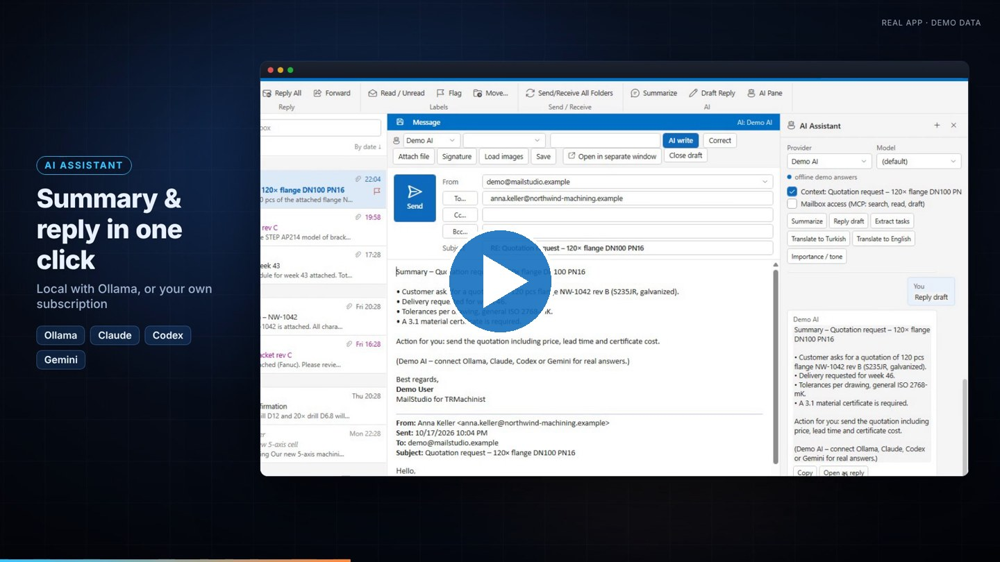</a>

**▶ [Watch the 60-second demo](https://github.com/yasinisiktek-cloud/MailStudio-AI-Email-Client/releases/download/v1.5.0/MailStudio_Demo_EN_1920x1080.mp4)** · [vertical](https://github.com/yasinisiktek-cloud/MailStudio-AI-Email-Client/releases/download/v1.5.0/MailStudio_Demo_EN_1080x1920.mp4) · [Türkçe](https://github.com/yasinisiktek-cloud/MailStudio-AI-Email-Client/releases/download/v1.5.0/MailStudio_Demo_TR_1920x1080.mp4)

</div>

---

## Why MailStudio?

In manufacturing, half of the work arrives by email: a quotation request with a DXF, a STEP model from a customer, a PDF
drawing with tolerances, an Excel delivery schedule, a CNC program to review. Regular mail clients just hand those files
to five different programs — if they are even installed.

**MailStudio opens all of them itself**, in a familiar Outlook-like layout, and adds an AI assistant that runs **locally**
(Ollama) or through the AI subscriptions you already have (Claude Code, Codex, Gemini CLI) — no API keys, and the AI can
never send mail on its own.

- 🧰 **Portable and self-contained** – unzip and run. No installation, no Microsoft Office or CAD software needed.
- 🔒 **Private by design** – mail is cached locally (like Outlook's OST), passwords are protected with Windows DPAPI,
  remote images are blocked, macros never run, attachments are never modified, no telemetry.
- 🇬🇧 🇹🇷 **English and Turkish** user interface (File → Dil / Language).

## Try it in 30 seconds

1. Download the latest **portable zip** from [Releases](https://github.com/yasinisiktek-cloud/MailStudio-AI-Email-Client/releases/latest) and unzip it.
2. Run `MailStudio.exe --demo` — a sample mailbox with real engineering attachments opens. No account, nothing is sent.
3. When you are ready, start `MailStudio.exe` and add your IMAP account (Gmail, Outlook.com, Microsoft 365, Yandex, any IMAP).

## Features

### 📬 A mail client that feels like classic Outlook

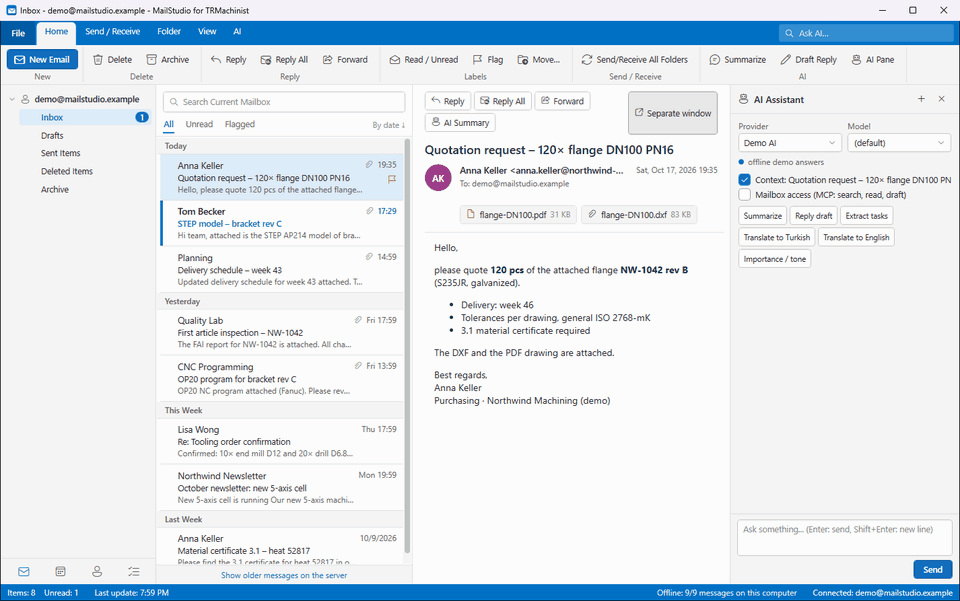

- Ribbon, folder pane, message list with date groups, reading pane, conversation view, flags, search (Ctrl+E)
- Offline copy of mail **and attachments**, instant opening, push notifications (IMAP IDLE), desktop alerts, tray mode
- Rich HTML composer with signatures, inline replies, pop-out windows, contact auto-complete, safe drafts and recovery
- **Conditional formatting** like Outlook — and you can create the rules in plain language with AI
- Gmail / Outlook.com / Microsoft 365 (OAuth or app password), Yandex and any IMAP/SMTP server
- Light and dark theme

### 🤖 AI assistant – local or with your own subscriptions

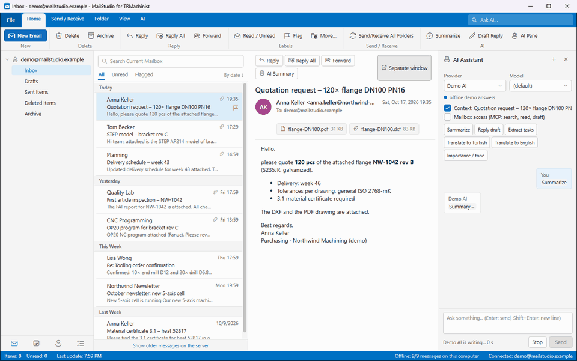

- Summarize, draft replies, extract tasks, translate, assess urgency — or just ask about the open mail
- Providers: **Ollama** (fully local), **Claude Code**, **OpenAI Codex**, **Gemini CLI** (your existing sign-in, no API key)
- **Mailbox access via MCP**: the AI can search your mail, read messages and leave drafts — it **cannot send**
- AI rewrites of your drafts are shown side by side and **blocked if numbers, dimensions or quantities change**
- Built-in [MCP server](docs/MCP.md) for Claude Desktop / Claude Code / Codex / Gemini / Goose

### 📐 STEP / 3D CAD viewer with native measuring

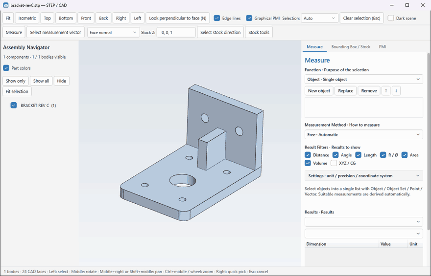

- Open STEP (AP203/AP214/AP242) assemblies, NX-style mouse (middle = rotate, middle+right = pan)
- **Measurements on the native B-Rep** (OpenCASCADE): distances, angles, radii, diameters, areas, volumes
- Bounding box / cylinder **raw stock** with allowances, stock weight by material, export the stock as STEP
- AP242 semantic and graphical **PMI**, look perpendicular to a face, part colors, assembly navigator

### 📏 DXF / DWG drawings

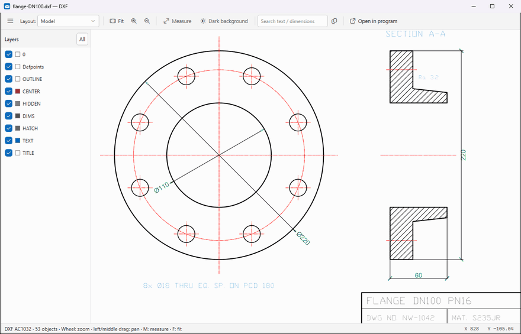

- Vector rendering (ezdxf) with layers, dimensions, hatches, blocks; unlimited zoom
- DWG through the bundled LibreDWG (or ODA File Converter if installed); DWFx/XPS viewer
- Measure with snapping to corners and end points, search text and dimension values

### 📄 PDF studio for technical drawings

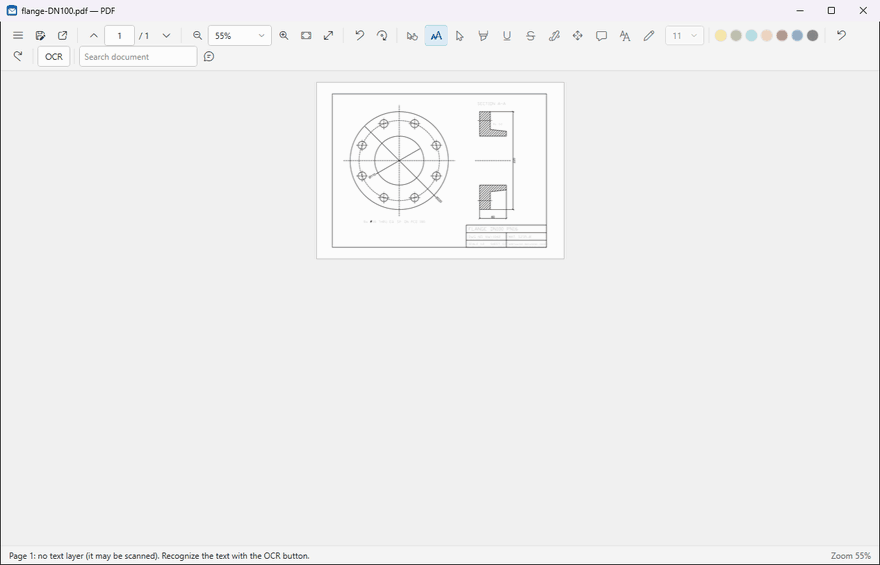

- Pixel-perfect rendering (supersampling) — small text and thin lines stay sharp
- Highlight, pen, shapes, sticky notes, add text, **correct text**, move/delete objects, rotate pages
- **OCR** for scanned drawings, then select and correct the recognized text
- Ask AI about the page or the whole document — answers cite the source page
- Edits are always saved to a **new** PDF; the attachment is never changed

### 📊 Word, Excel, PowerPoint – view and edit without Office

| Excel editor | Word view | PowerPoint view |
|---|---|---|
| 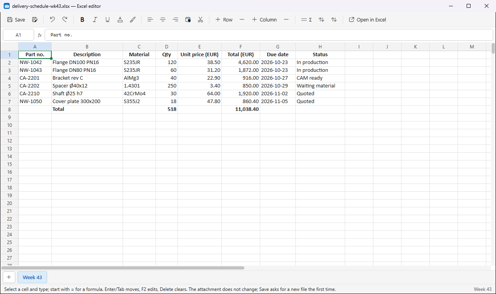 | 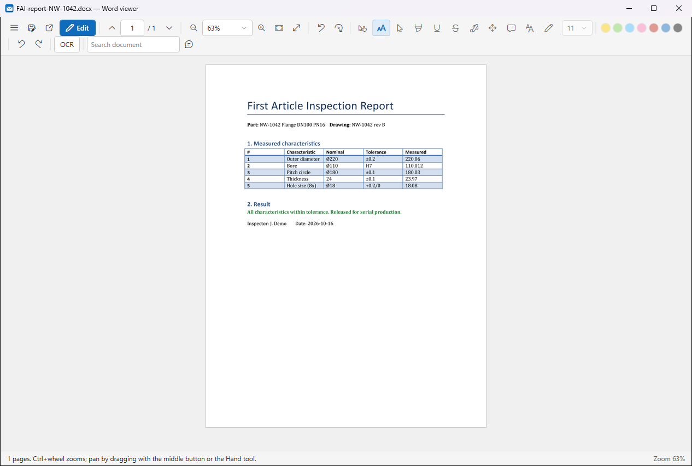 | 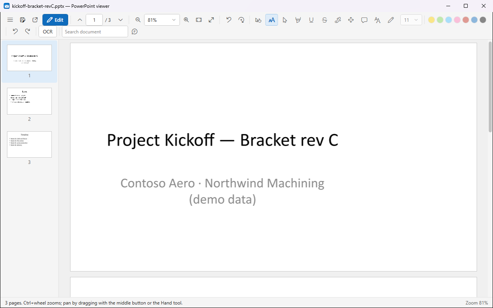 |

- Excel editor: formulas, formatting, merge, sort, Σ, copy/paste with Excel, sheets
- Word editor: page view, headings, lists, tables, images, links; PowerPoint: slide texts, tables, notes, reorder
- Old formats (doc, xls, ppt, odt, ods, odp, rtf) are converted automatically — with Microsoft Office if present,
  otherwise with the bundled LibreOffice

### 🛠️ CNC programs, code, CSV, ZIP, mail files

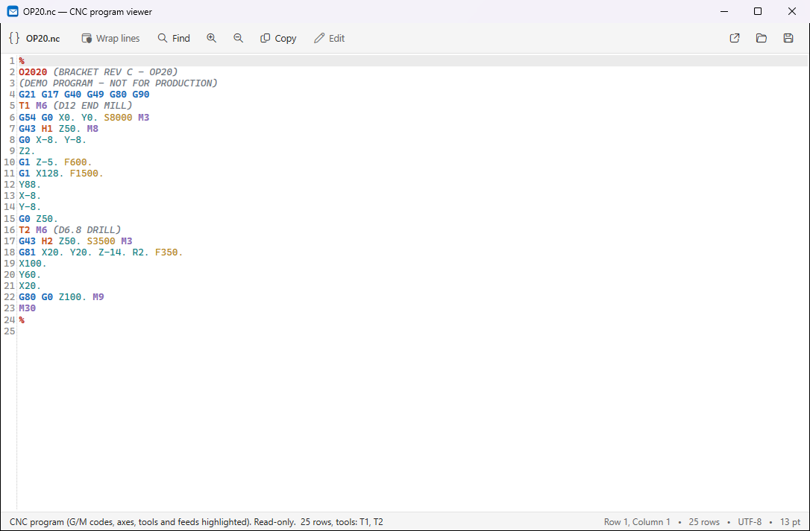

- G-code highlighting (G/M codes, axes, tools, feeds) with tool list
- Code viewer with syntax highlighting, CSV as a table, ZIP browser, .eml viewer
- Executables and scripts from attachments are never run directly

<details>
<summary><b>More screenshots</b></summary>

| | |
|---|---|
| Dark theme<br>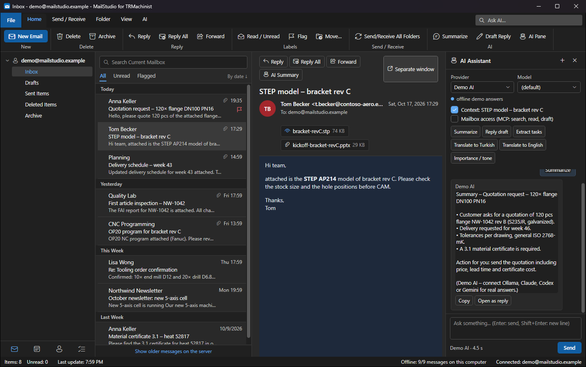 | Inline reply<br>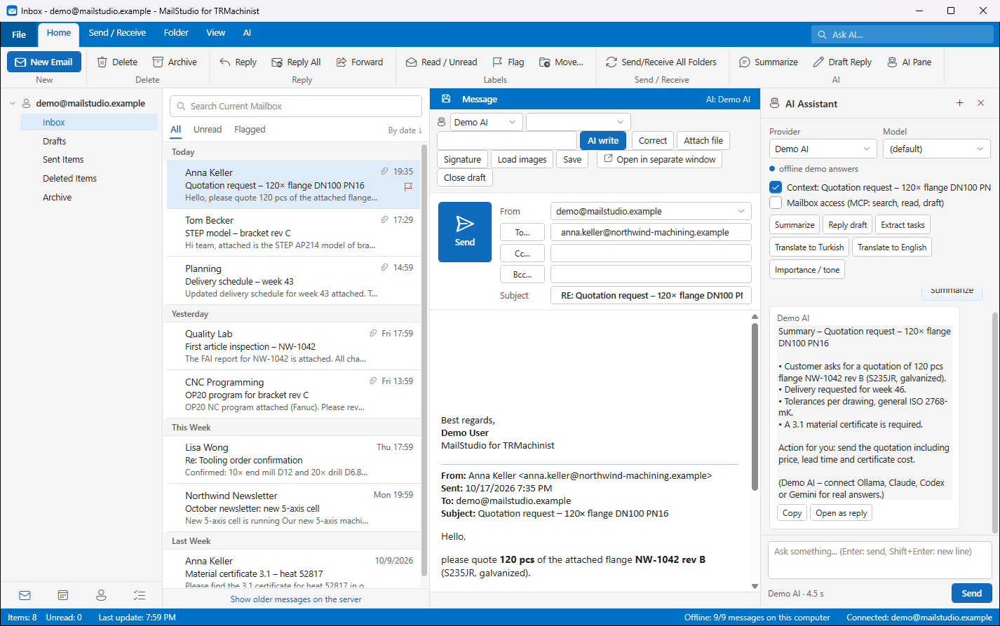 |
| PDF studio<br>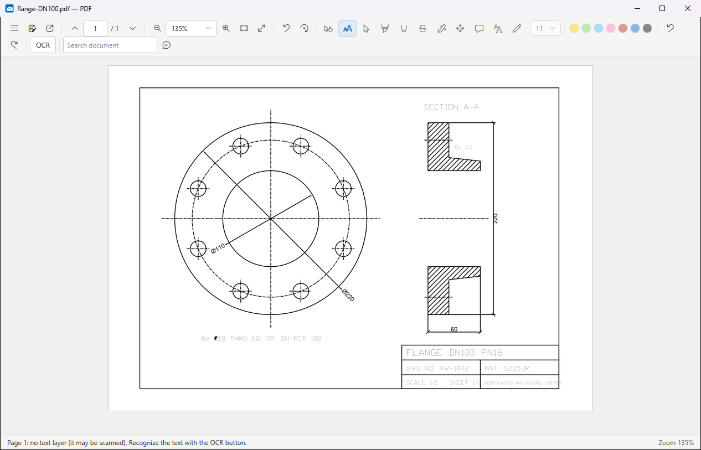 | STEP viewer<br>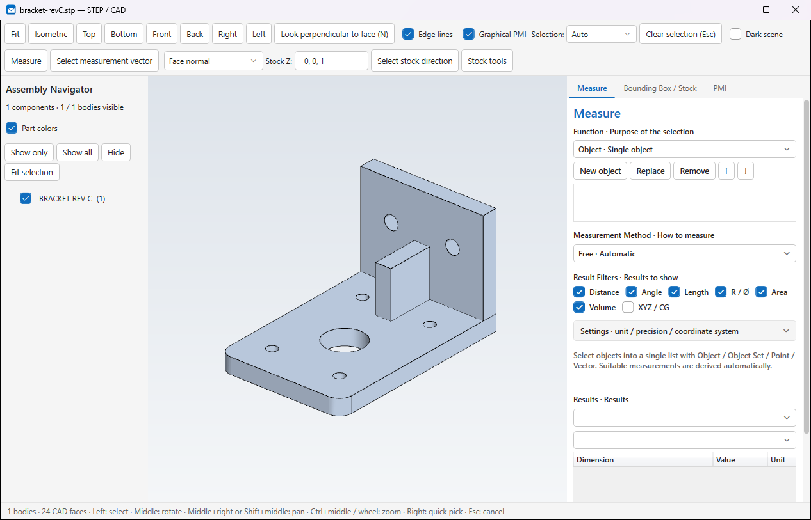 |
| Conditional formatting<br>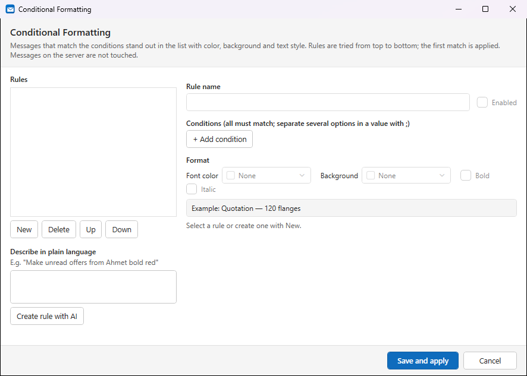 | Add account<br>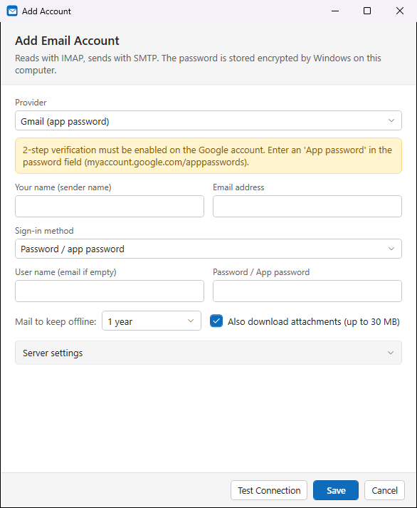 |

</details>

## Privacy & security

- Mail stays on your computer: local SQLite cache in `%AppData%\MailStudio`, passwords encrypted with Windows DPAPI.
- No telemetry, no analytics, no cloud service of ours. The only network traffic is to your mail server and the AI
  provider **you** choose.
- Remote images are blocked by default; HTML is sanitized; scripts never run in mail.
- Office files open read-only with macros disabled; attachments are never overwritten.
- The AI cannot send mail. Content of mails is passed to the AI as data and is fenced against prompt injection.

## Requirements

- Windows 10 or 11, x64
- Optional: [Ollama](https://ollama.com) for local AI, or Claude Code / Codex / Gemini CLI signed in
- For Microsoft 365 / Outlook.com OAuth: a free app registration — see [OAuth setup](docs/OAUTH_SETUP.md)

## Build from source

```powershell
git clone https://github.com/yasinisiktek-cloud/MailStudio-AI-Email-Client.git
cd MailStudio-AI-Email-Client
dotnet build MailStudio.sln
dotnet run --project src\MailStudio -- --demo
```

Full instructions (technical worker, bundled converters, release package): **[docs/BUILDING.md](docs/BUILDING.md)** ·
Tests: **[tests/README.md](tests/README.md)**

## Roadmap

- [x] STEP, DXF/DWG, PDF studio, Office editors, CNC viewer
- [x] English / Turkish UI, demo mode
- [ ] **CATPart, NX PRT and SolidWorks SLDPRT viewers** (in progress)
- [ ] Calendar and tasks
- [ ] More UI languages — translations are a single JSON file ([how to](CONTRIBUTING.md#translations))

## Contributing

Issues, ideas and pull requests are welcome — see [CONTRIBUTING.md](CONTRIBUTING.md).
If MailStudio helps you, **please give it a ⭐ — it really helps the project grow.**

## License

[MIT](LICENSE) © 2026 TRMachinist.
Bundled third-party components keep their own licenses (LibreOffice MPL-2.0, LibreDWG GPLv3 as a separate program,
OpenCASCADE LGPL-2.1 with exception, ezdxf MIT, PDFium, ClosedXML, Open XML SDK, MailKit and others) — see
`ThirdPartyNotices` in the release package and [THIRD_PARTY.md](THIRD_PARTY.md).
