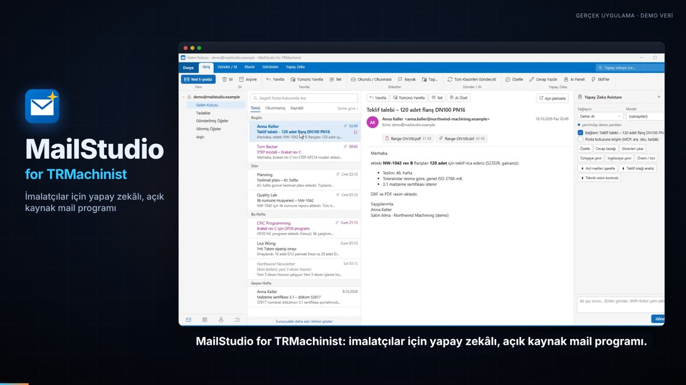
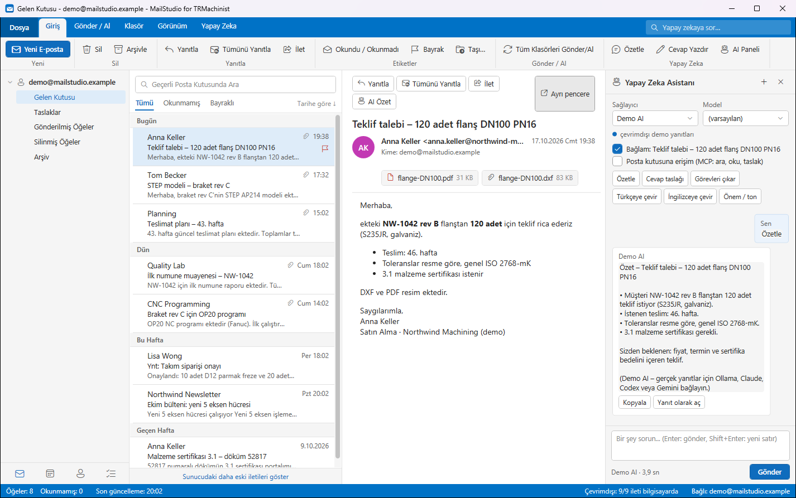

<div align="center">


# MailStudio for TRMachinist

**Mühendisler ve talaşlı imalatçılar için klasik Outlook düzeninde masaüstü mail istemcisi —<br>
STEP, DXF/DWG, PDF teknik resim, Office dosyaları ve CNC programlarını doğrudan gelen kutusundan açın, yerel yapay zekayla.**

[](https://github.com/yasinisiktek-cloud/MailStudio-AI-Email-Client/releases/latest)
[](LICENSE)


[](https://www.linkedin.com/in/trmachinist/)
[](https://www.instagram.com/trmachinist/)

[English](README.md) · **Türkçe**

<a href="https://github.com/yasinisiktek-cloud/MailStudio-AI-Email-Client/releases/download/v1.5.0/MailStudio_Demo_TR_1920x1080.mp4"></a>

**▶ [60 saniyelik tanıtım videosunu izleyin](https://github.com/yasinisiktek-cloud/MailStudio-AI-Email-Client/releases/download/v1.5.0/MailStudio_Demo_TR_1920x1080.mp4)** · [dikey](https://github.com/yasinisiktek-cloud/MailStudio-AI-Email-Client/releases/download/v1.5.0/MailStudio_Demo_TR_1080x1920.mp4) · [English](https://github.com/yasinisiktek-cloud/MailStudio-AI-Email-Client/releases/download/v1.5.0/MailStudio_Demo_EN_1920x1080.mp4)

</div>

---

## Neden MailStudio?

İmalatta işin yarısı mail ile gelir: DXF ekli teklif isteği, müşteriden STEP model, toleranslı PDF resim, Excel
teslim planı, kontrol edilecek CNC programı. Sıradan mail programları bu dosyaları beş farklı programa yollar — kuruluysa.

**MailStudio hepsini kendi açar**, tanıdık Outlook düzeninde; üstüne **yerel** (Ollama) ya da zaten sahip olduğunuz
aboneliklerle (Claude Code, Codex, Gemini CLI) çalışan bir yapay zeka asistanı ekler — API anahtarı gerekmez ve yapay
zeka asla kendi başına mail gönderemez.

- 🧰 **Taşınabilir, her şey içinde** – zip'i açın, çalıştırın. Kurulum, Microsoft Office veya CAD programı gerekmez.
- 🔒 **Gizlilik öncelikli** – mailler yerelde önbelleklenir (Outlook OST gibi), parolalar Windows DPAPI ile korunur,
  uzak resimler engellenir, makrolar çalışmaz, ekler asla değiştirilmez, telemetri yoktur.
- 🇹🇷 🇬🇧 **Türkçe ve İngilizce** arayüz (Dosya → Dil / Language).

## 30 saniyede deneyin

1. [Sürümler](https://github.com/yasinisiktek-cloud/MailStudio-AI-Email-Client/releases/latest) sayfasından **taşınabilir zip**'i indirip açın.
2. `MailStudio.exe --demo` çalıştırın — gerçek mühendislik ekleri olan örnek bir posta kutusu açılır. Hesap gerekmez, hiçbir şey gönderilmez.
3. Hazır olduğunuzda `MailStudio.exe`'yi açıp IMAP hesabınızı ekleyin (Gmail, Outlook.com, Microsoft 365, Yandex, her IMAP).

## Özellikler

### 📬 Klasik Outlook hissi veren mail istemcisi

- Şerit, klasör bölmesi, tarih gruplu ileti listesi, okuma bölmesi, konuşma görünümü, bayraklar, arama (Ctrl+E)
- Mail **ve eklerin** çevrimdışı kopyası, anında açılış, anlık bildirim (IMAP IDLE), masaüstü uyarıları, tepsi modu
- İmzalı zengin HTML düzenleyici, satır içi yanıt, ayrı pencere, kişi otomatik tamamlama, güvenli taslak ve kurtarma
- Outlook'taki gibi **koşullu biçimlendirme** — kuralları yapay zekaya düz cümleyle de yazdırabilirsiniz
- Gmail / Outlook.com / Microsoft 365 (OAuth veya uygulama parolası), Yandex ve her IMAP/SMTP sunucusu
- Açık ve koyu tema

### 🤖 Yapay zeka asistanı – yerel ya da kendi aboneliklerinizle



- Özetle, yanıt taslağı, görevleri çıkar, çevir, aciliyet — ya da açık mail hakkında soru sorun
- Sağlayıcılar: **Ollama** (tamamen yerel), **Claude Code**, **OpenAI Codex**, **Gemini CLI** (mevcut oturumunuz, API anahtarı yok)
- **MCP ile posta kutusu erişimi**: yapay zeka arar, okur, taslak bırakır — **gönderemez**
- Taslak yeniden yazımları yan yana gösterilir; **sayı, ölçü veya adet değişirse uygulanamaz**
- Claude Desktop / Claude Code / Codex / Gemini / Goose için yerleşik [MCP sunucusu](docs/MCP.md)

### 📐 STEP / 3B CAD görüntüleyici, native ölçüm

- STEP (AP203/AP214/AP242) montajları, NX fare düzeni (orta = döndür, orta+sağ = kaydır)
- **Native B-Rep üzerinde ölçüm** (OpenCASCADE): mesafe, açı, yarıçap, çap, alan, hacim
- Paylı bounding box / silindir **hammadde**, malzemeye göre stok ağırlığı, stoku STEP olarak dışa aktarma
- AP242 semantik ve grafik **PMI**, yüzeye dik bakış, parça renkleri, montaj ağacı

### 📏 DXF / DWG çizimler

- Katman, ölçü, tarama ve bloklarla vektör çizim (ezdxf); sınırsız yakınlaştırma
- Paketteki LibreDWG ile DWG (kuruluysa ODA File Converter); DWFx/XPS görüntüleyici
- Köşe/uç noktaya yakalamalı ölçme, yazı ve ölçü değerlerinde arama

### 📄 Teknik resimler için PDF stüdyosu

- Piksel hassas çizim (süper örnekleme) — küçük yazı ve ince çizgiler keskin kalır
- Vurgula, kalem, şekiller, yapışkan not, metin ekle, **metni düzelt**, nesne taşı/sil, sayfa döndür
- Taranmış resimler için **OCR**, tanınan metni seçme ve düzeltme
- Sayfa ya da belge hakkında yapay zekaya sorun — yanıtlar kaynak sayfayı gösterir
- Düzenlemeler her zaman **yeni** PDF'ye kaydedilir; ek dosyası değişmez

### 📊 Office olmadan Word, Excel, PowerPoint

- Excel düzenleyici: formül, biçim, birleştir, sırala, Σ, Excel ile kopyala/yapıştır, sayfalar
- Word düzenleyici: sayfa görünümü, başlıklar, listeler, tablolar, resimler; PowerPoint: slayt metinleri, tablolar, notlar, sıralama
- Eski biçimler (doc, xls, ppt, odt, ods, odp, rtf) otomatik çevrilir — Office kuruluysa onunla, değilse paketteki LibreOffice ile

### 🛠️ CNC programları, kod, CSV, ZIP, mail dosyaları

- Takım listesiyle G-kodu renklendirme (G/M kodları, eksenler, takımlar, ilerlemeler)
- Renklendirmeli kod görüntüleyici, tablo olarak CSV, ZIP gezgini, .eml görüntüleyici
- Eklerdeki çalıştırılabilir dosya ve betikler asla doğrudan çalıştırılmaz

Ekran görüntüleri ve animasyonlar için [İngilizce README](README.md)'ye bakın.

## Gizlilik ve güvenlik

- Mailler bilgisayarınızda kalır: `%AppData%\MailStudio` içinde yerel SQLite önbellek, parolalar Windows DPAPI ile şifreli.
- Telemetri, analitik veya bize ait bulut hizmeti yoktur. Ağ trafiği yalnızca mail sunucunuza ve **sizin** seçtiğiniz yapay zeka sağlayıcısınadır.
- Uzak resimler varsayılan olarak engellidir; HTML temizlenir; mail içinde betik çalışmaz.
- Office dosyaları salt okunur ve makrolar kapalı açılır; ekler asla üzerine yazılmaz.
- Yapay zeka mail gönderemez. Mail içeriği yapay zekaya veri olarak verilir ve istem enjeksiyonuna karşı çitlenir.

## Gereksinimler

- Windows 10 veya 11, x64
- İsteğe bağlı: yerel yapay zeka için [Ollama](https://ollama.com) ya da oturum açılmış Claude Code / Codex / Gemini CLI
- Microsoft 365 / Outlook.com OAuth için ücretsiz uygulama kaydı — bkz. [OAuth kurulumu](docs/OAUTH_KURULUM.md)

## Kaynaktan derleme

```powershell
git clone https://github.com/yasinisiktek-cloud/MailStudio-AI-Email-Client.git
cd MailStudio-AI-Email-Client
dotnet build MailStudio.sln
dotnet run --project src\MailStudio -- --demo
```

Ayrıntılar: [docs/BUILDING.md](docs/BUILDING.md) · Testler: [tests/README.md](tests/README.md)

## Yol haritası

- [x] STEP, DXF/DWG, PDF stüdyosu, Office düzenleyiciler, CNC görüntüleyici
- [x] Türkçe / İngilizce arayüz, demo modu
- [ ] **CATPart, NX PRT ve SolidWorks SLDPRT görüntüleyiciler** (geliştiriliyor)
- [ ] Takvim ve görevler
- [ ] Daha fazla arayüz dili

## Katkı

Hata bildirimi, fikir ve pull request'ler memnuniyetle karşılanır — bkz. [CONTRIBUTING.md](CONTRIBUTING.md).
MailStudio işinize yaradıysa **bir ⭐ verin — projenin büyümesine gerçekten yardım ediyor.**

## Geliştirici

**TRMachinist** — talaşlı imalat ve üretim için yazılımlar.
Soru, fikir veya iş birliği için: **[LinkedIn](https://www.linkedin.com/in/trmachinist/)** · **[Instagram](https://www.instagram.com/trmachinist/)**

## Lisans

[MIT](LICENSE) © 2026 TRMachinist. Paketlenen üçüncü taraf bileşenler kendi lisanslarını korur — bkz. [THIRD_PARTY.md](THIRD_PARTY.md).
